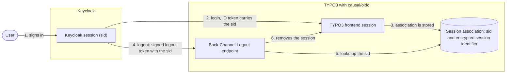
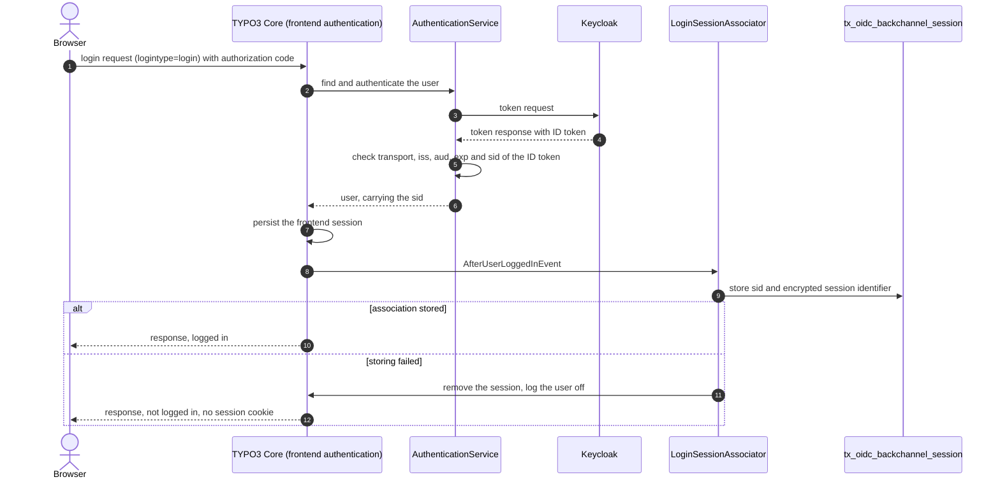
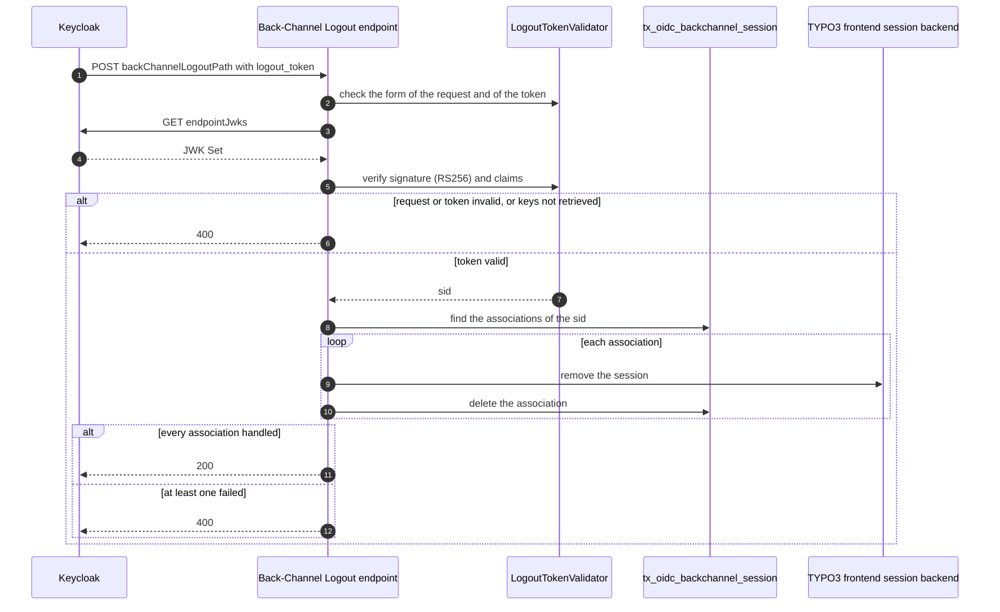
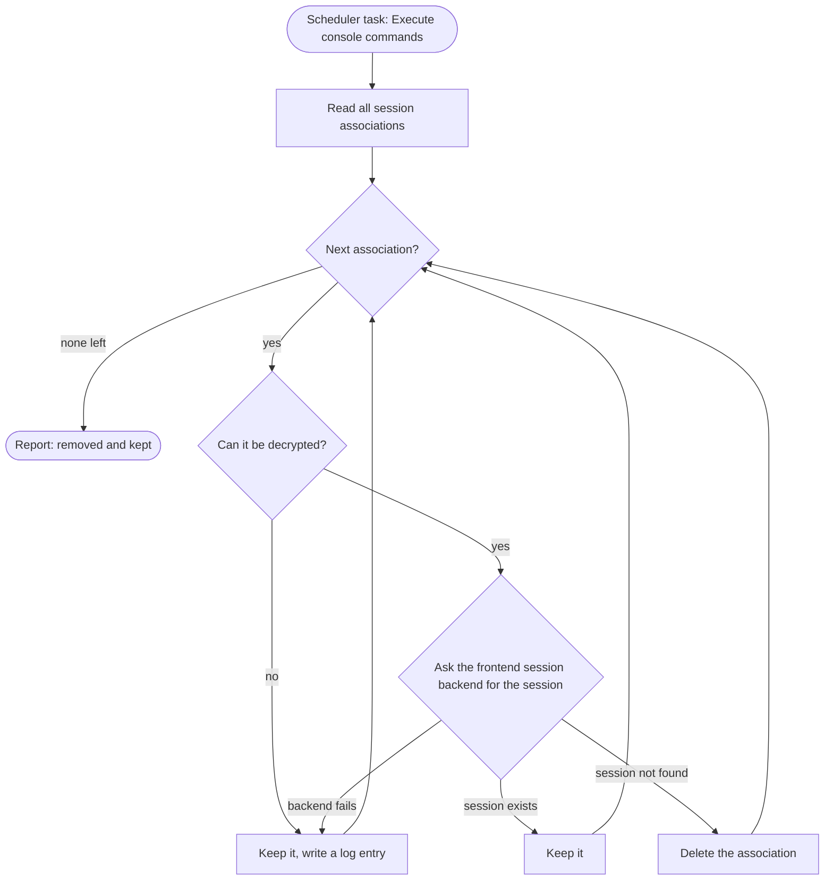

# Back-Channel Logout

## Purpose and scope

With Back-Channel Logout, a logout at the identity provider ends the TYPO3 frontend sessions
that were created from the identity-provider session that was logged out. The extension
implements the relying-party side of
[OpenID Connect Back-Channel Logout 1.0](https://openid.net/specs/openid-connect-backchannel-1_0.html).

This document describes the Back-Channel Logout behaviour of this fork of `causal/oidc` and
nothing else. The documented integration target is **Keycloak**. Other identity providers are
not covered here.

> **Status of the Keycloak integration.** The feature is covered by automated tests that run
> against a simulated identity provider. It has not been verified against a running Keycloak
> instance. The Keycloak settings named in this document are the ones to check, and every item
> of the [integration checklist](#integration-checklist) is outstanding until it has been run
> in a real environment.

## The problem and the solution

A user who signs in to the TYPO3 frontend through Keycloak has two independent sessions:

- the **Keycloak session**, identified by a session identifier (`sid`),
- the **TYPO3 frontend session**, identified by the TYPO3 session cookie.

TYPO3 creates its session at login and never asks Keycloak again. Without Back-Channel Logout,
a logout in Keycloak, or in a system in front of Keycloak, therefore does not end the TYPO3
frontend session: a browser that is left open stays logged in to TYPO3 until that session
expires on its own.

The solution has two halves:

1. **At login**, TYPO3 remembers which of its frontend sessions belongs to which Keycloak
   session (`sid`).
2. **At logout**, Keycloak sends a signed logout token that names the `sid` directly to TYPO3,
   server to server. TYPO3 validates the token and immediately removes exactly the frontend
   sessions remembered for that `sid`.



## Architecture overview

| Part | Class | Responsibility |
|---|---|---|
| Frontend login | `Service\AuthenticationService`, `BackChannelLogout\IdTokenValidator` | Checks the ID token of the token response and hands the `sid` on with the user. |
| Session association at login | `BackChannelLogout\LoginSessionAssociator` | Listens to the Core's `AfterUserLoggedInEvent` and stores the association for the session the Core persisted; ends the login where that fails. |
| Stored session association | `BackChannelLogout\SessionAssociationRepository` | Owns the table `tx_oidc_backchannel_session` and the encryption of the session identifier. |
| Back-Channel Logout endpoint | `Middleware\BackChannelLogoutEndpoint` | Frontend middleware that receives the logout notification and answers `200` or `400`. |
| Key retrieval | `BackChannelLogout\JwkSetRetriever` | Requests the JWK Set from `endpointJwks` for each notification. |
| Logout token validation | `BackChannelLogout\LogoutTokenValidator` | Verifies signature and claims of the logout token and returns its `sid`. |
| Frontend session invalidation | `BackChannelLogout\SessionLogout` | Removes the frontend sessions of a `sid` through the TYPO3 session backend, then their associations. |
| Cleanup command | `Command\BackChannelLogoutCleanupCommand` | Removes associations whose frontend session no longer exists. |

All class names are relative to the namespace `Causal\Oidc`.

How they work together: the login writes an association, the logout endpoint consumes it, and
the cleanup command removes the associations that no logout ever consumed because their session
ended in TYPO3 first. The endpoint needs no site, no page and no frontend user; the signed
logout token is its only credential. Backend sessions, frontend logins through other
mechanisms and the sessions of other Keycloak sessions are never touched.

## Configuration

Three provider keys in `config/system/oidc.yaml`:

| Key | Default | Meaning |
|---|---|---|
| `issuer` | empty | The issuer identifier of the identity provider, compared verbatim with the `iss` claim. |
| `endpointJwks` | empty | The URL of the identity provider's JWK Set. No discovery document is read. |
| `backChannelLogoutPath` | `/oidc/backchannel-logout` | The absolute URL path of the logout endpoint on the TYPO3 frontend. |

```yaml
    issuer: '%env(TYPO3_OIDC_ISSUER)%'
    endpointJwks: '%env(TYPO3_OIDC_ENDPOINT_JWKS)%'
    backChannelLogoutPath: /oidc/backchannel-logout
```

For Keycloak, both values belong to the realm:

| Key | Keycloak value |
|---|---|
| `issuer` | `https://<keycloak-host>/realms/<realm>` |
| `endpointJwks` | `https://<keycloak-host>/realms/<realm>/protocol/openid-connect/certs` |

The exact values are published by the realm's discovery document
(`https://<keycloak-host>/realms/<realm>/.well-known/openid-configuration`) as `issuer` and
`jwks_uri`. The extension does not read that document; copy the values from it. `issuer` must
match the `iss` claim character for character, a trailing slash included.

**The feature is active** exactly when `issuer` and `endpointJwks` are both set. With neither
or only one of them, the extension behaves as without the feature.

Requirements while the feature is active:

- **Explicit login request.** A frontend user is authenticated through OpenID Connect only on
  a login request, that is a request carrying `logintype=login`. The login link, the OIDC Login
  plugin and a felogin form send it. The TYPO3 settings `FE_alwaysFetchUser` and
  `FE_fetchUserIfNoSession` are not changed, but they no longer trigger an OpenID Connect
  authentication on a request without `logintype=login`.
- **HTTPS with certificate validation.** `endpointToken` and `endpointJwks` must be `https`
  URLs, and certificate validation (`$GLOBALS['TYPO3_CONF_VARS']['HTTP']['verify']`) must not
  be disabled.
- **PHP extensions.** `ext-sodium` (encryption of the stored session identifier) and
  `ext-openssl` (verification of the `RS256` signature) are required.
- **Database schema.** The schema must be updated once, for the table described below.

## Persistence model

One table, `tx_oidc_backchannel_session`, with two columns and nothing else:

| Column | Content |
|---|---|
| `sid` | The Keycloak session identifier from the ID token. |
| `session_identifier` | The TYPO3 frontend session identifier, encrypted. |

- **Keyed by both columns.** The primary key is the pair (`sid`, `session_identifier`). One
  `sid` can therefore have several rows: several TYPO3 sessions created from the same Keycloak
  session are all ended by one logout.
- **Why the session identifier is encrypted.** A TYPO3 session identifier is a credential:
  whoever knows it can take over the session. It is stored with authenticated encryption
  (libsodium `secretbox`, a fresh random nonce per value) under a key derived from the TYPO3
  `encryptionKey`, so a copy of the table alone does not allow session hijacking. Session
  identifiers are never written to the log or to command output.
- **Nothing else is stored.** No token, no subject (`sub`), no user data, no timestamp.
- **Consequence of a changed `encryptionKey`.** Existing rows can no longer be decrypted. Such
  rows are never deleted automatically, because a failed decryption does not prove that the
  session is gone; see [Runtime behaviour](#runtime-behaviour).

## Runtime behaviour

### Login



On a frontend login with the feature active:

1. After the token response and before any frontend user record is created or changed, the
   login is denied unless
   - the transport requirements above hold for `endpointToken` and `endpointJwks`,
   - the token response carries an ID token whose payload can be read,
   - its `iss` equals the configured `issuer`,
   - its `aud` names only the configured `clientKey`,
   - its `exp` lies in the future,
   - it carries a non-empty `sid`,
   - and, where `endpointUserInfo` is configured, the `sub` returned there equals the `sub` of
     the ID token.

   The signature of the ID token is not verified at login and no JWKS request is made: the
   token comes directly from the token endpoint over the validated HTTPS connection.
2. The TYPO3 Core persists the frontend session and dispatches `AfterUserLoggedInEvent`.
3. The extension stores the association under the identifier of the session the Core
   persisted.
4. If storing fails, the login is ended: the session is removed, the user is logged off and
   the response is sent without a user and without a session cookie.

Where the Core is configured to authenticate again inside an existing session
(`FE_alwaysFetchUser`), that session is left with the association of the latest login only.

Backend logins are not affected. With the feature not active, a login behaves as before and
writes no association.

### Logout notification



The endpoint is a frontend middleware. It acts only when the feature is active **and** the
request is a `POST` **and** its path equals `backChannelLogoutPath` exactly. Every other
request, a `GET` to that path included, is passed on and not answered by the endpoint.

A handled request is processed in this order; the first failing step answers `400` and nothing
later runs:

1. **Request form.** The content type is `application/x-www-form-urlencoded`, the body carries
   a `logout_token`, the token is a compact JWS whose header names `RS256` as `alg` and carries
   a `kid`. A request that fails here causes no outbound request.
2. **Transport.** `endpointJwks` is an `https` URL and certificate validation is enabled.
3. **Key retrieval.** One `GET` to `endpointJwks`, with a connect timeout of 3 seconds, a total
   timeout of 5 seconds and without following redirects. The JWK Set is requested for every
   notification and cached nowhere.
4. **Signature and time claims.** The key is found by `kid`, the `RS256` signature verifies,
   `exp` has not passed, `iat` and, if present, `nbf` are not in the future. No leeway is
   applied.
5. **Claims.** `iss` equals `issuer`; `aud` is or contains `clientKey`; `exp`, `iat` and `jti`
   are present; `events` carries the member
   `http://schemas.openid.net/event/backchannel-logout`; there is no `nonce`; `sid` is a
   non-empty string. A logout token without `sid` ends no session: there is no logout by
   subject.
6. **Logout.** Only now are the associations of the `sid` read. For each one the session is
   removed through the TYPO3 frontend session backend and then the association is deleted. A
   session the backend no longer holds counts as removed. An association that cannot be
   decrypted, or whose session or row cannot be removed, is kept and counted as failed; the
   remaining associations are still processed.

The answer has no body and carries `Cache-Control: no-store`:

| Status | Meaning |
|---|---|
| `200` | The sessions of the `sid` were removed, or there was none left to remove: unknown `sid`, repeated notification, session already expired or logged out in TYPO3. |
| `400` | The request or the logout token is invalid, the keys could not be retrieved, or at least one session could not be removed. The reason is written to the log, without the token and without any session identifier. |

Repeated notifications are harmless: the second one finds no association and is answered with
`200`. Logout tokens are not stored and replays are not tracked.

### Cleanup command

A frontend session that expires or is logged out in TYPO3 leaves its association behind,
because no logout notification consumes it. The command removes these leftovers:

```bash
vendor/bin/typo3 oidc:backchannel:cleanup
```



- Only the session backend's answer "session not found" deletes an association.
- An association is kept when its session still exists, when the session backend could not be
  asked, and when its stored value cannot be decrypted; the latter two are logged.
- The command takes no arguments and also runs while the feature is not active, so leftovers
  can still be removed after it was switched off.
- It is meant to run periodically through the TYPO3 Scheduler task "Execute console commands".
  The extension schedules nothing by itself.

The command only removes obsolete associations. It never ends, extends or otherwise manages a
frontend session.

## Known limitations

- **Not verified against a real Keycloak.** All automated tests use a simulated identity
  provider with really signed tokens and real TYPO3 session handling. The integration with a
  running Keycloak instance, and with any system in front of it, has to be verified in a real
  environment with the checklist below.
- **One JWKS request per notification.** The JWK Set is not cached. A logout depends on
  `endpointJwks` being reachable and answering within 5 seconds with a JWK Set that can be read
  as a whole; otherwise the notification is answered with `400` and the session stays.
- **Event-driven, no synchronisation.** There is no continuous comparison of Keycloak and TYPO3
  sessions. A notification that TYPO3 does not receive ends no session, and TYPO3 retries
  nothing.
- **Logout during a login.** A notification that arrives while a login is in progress, between
  the retrieval of the token and the storing of the association, is lost: the TYPO3 session of
  that login stays.
- **No clock tolerance.** No leeway is applied to `exp`, `iat` and `nbf`; the clocks of both
  systems must be synchronised.
- **Double failure at login.** A login is ended when its association cannot be stored. If the
  session backend then also fails to remove the session of that login, the request continues
  without a user and the session cookie is removed, but the session stays in the session
  backend: a client that already held the cookie of that session and keeps sending it remains
  logged in until the session expires or is removed. The failure is logged.
- **The cleanup command does not manage active sessions.** It removes associations of sessions
  that no longer exist and nothing else.

## Integration checklist

To be worked through in the real environment, against the real Keycloak realm. Until then every
item is outstanding.

### Keycloak

- [ ] The client's **Backchannel logout URL** is the scheme and host of the TYPO3 frontend
      followed by `backChannelLogoutPath`.
- [ ] Logout tokens and ID tokens carry `sid` (client setting **Backchannel logout session
      required** enabled).
- [ ] Logout tokens carry `iss`, `aud`, `iat`, `exp`, `jti` and the back-channel logout event,
      and no `nonce`. A token that lacks one of them is answered with `400`.
- [ ] Tokens are signed with `RS256`, and the JWK Set at `endpointJwks` is read without error.
- [ ] TYPO3 and Keycloak reach each other over HTTPS with trusted certificates: Keycloak the
      logout endpoint, TYPO3 the token endpoint and `endpointJwks`.
- [ ] The clocks of both systems are synchronised.
- [ ] A logout in an upstream system ends the session in Keycloak.

### TYPO3

- [ ] `issuer` and `endpointJwks` are configured with the values of the realm.
- [ ] Certificate validation is enabled.
- [ ] The PHP extensions `sodium` and `openssl` are loaded.
- [ ] The database schema is updated.
- [ ] The cleanup command is scheduled.

### Checks

- [ ] A login creates a session association.
- [ ] An upstream logout ends the TYPO3 session immediately; the notification is answered
      with `200`.
- [ ] A logout directly in Keycloak ends the TYPO3 session immediately; the notification is
      answered with `200`.
- [ ] Only the TYPO3 sessions of the logged-out Keycloak session end, and all of them.
- [ ] A logout after a local TYPO3 logout is answered with `200`.
- [ ] Logins through other mechanisms are unaffected.
- [ ] Logout works after Keycloak rotated its signing key.
- [ ] With an unreachable `endpointJwks` the notification is answered with `400` and the
      session is kept.
- [ ] The cleanup command removes only the associations of sessions that no longer exist.
- [ ] With Back-Channel Logout not configured, login works as before.
