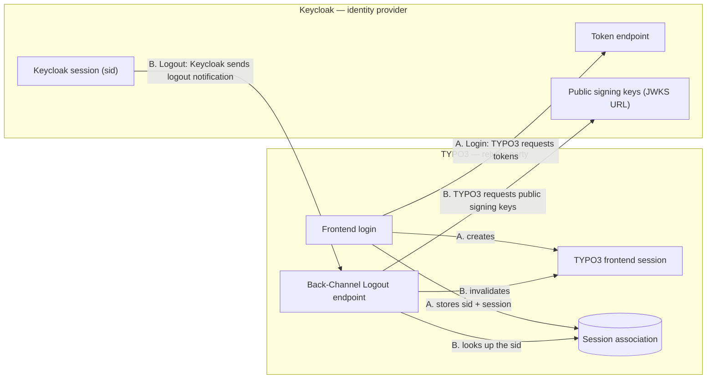
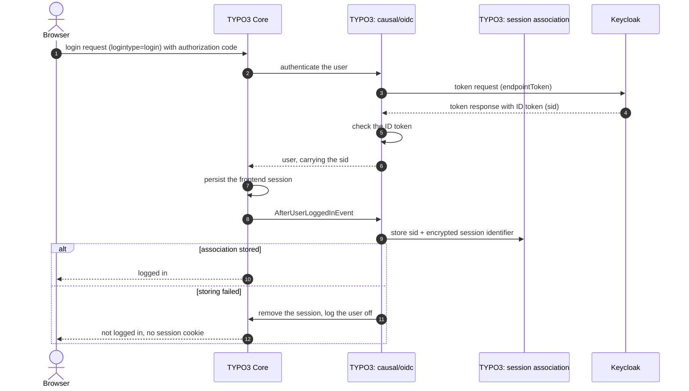
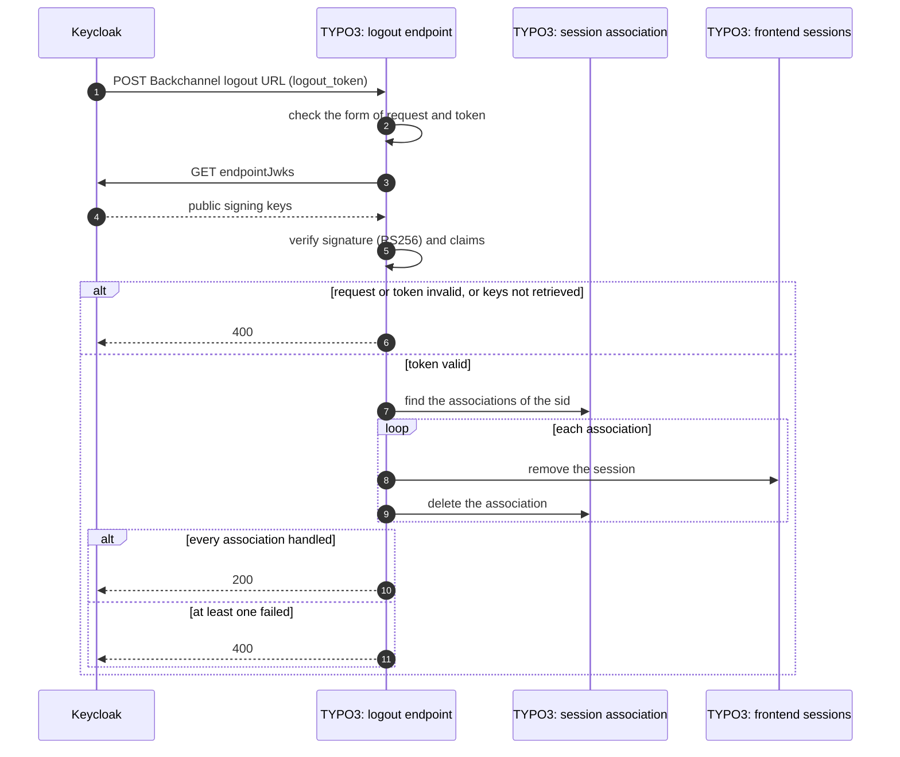
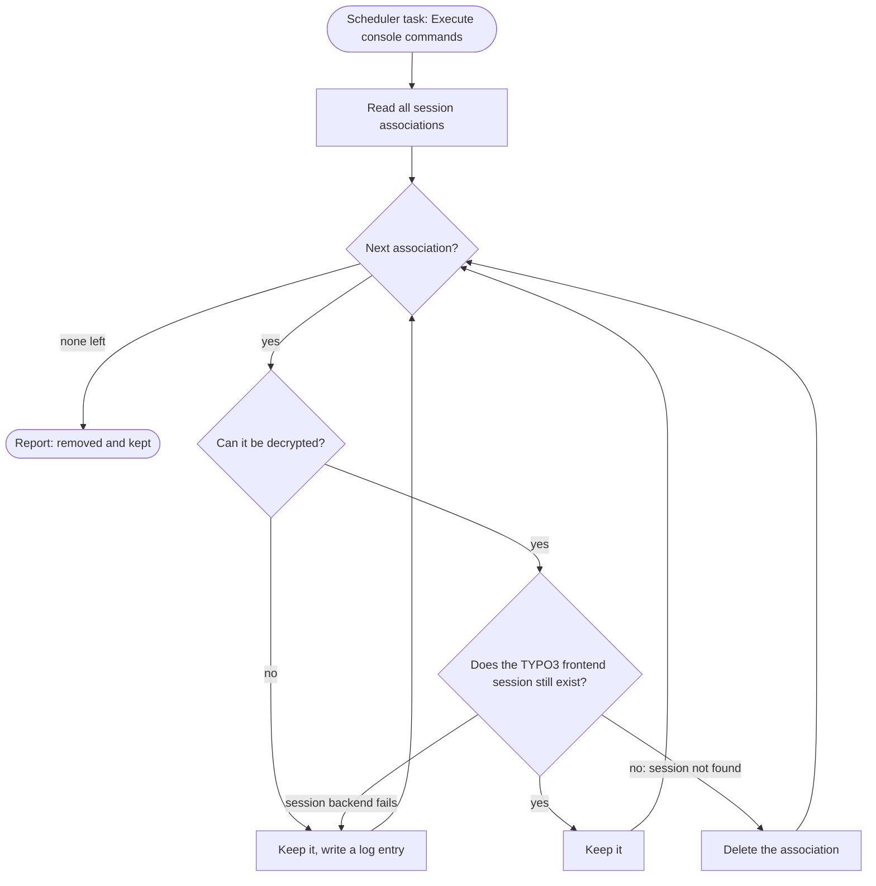

# Back-Channel Logout with Keycloak

## 1. Purpose

A user who signs in to the TYPO3 frontend through Keycloak has two independent sessions: the
**Keycloak session** and the **TYPO3 frontend session**. TYPO3 creates its session at login and
never asks Keycloak again, so a logout in Keycloak leaves the TYPO3 session alive until it
expires on its own.

With Back-Channel Logout, Keycloak tells TYPO3 about the logout, server to server, and TYPO3
immediately ends exactly the frontend sessions that were created from the Keycloak session that
was logged out. The extension implements the relying-party side of
[OpenID Connect Back-Channel Logout 1.0](https://openid.net/specs/openid-connect-backchannel-1_0.html).

This document describes that feature of this fork of `causal/oidc`, with **Keycloak** as the
identity provider. It covers frontend sessions only; backend sessions and frontend logins
through other mechanisms are never touched.

### Supported logout scope

Back-Channel Logout operates exclusively on the Keycloak session identifier (`sid`). When
Keycloak ends a session and sends a valid logout notification carrying its `sid`, the TYPO3
frontend sessions associated with that `sid` are invalidated — for whatever reason Keycloak
ended the session.

Not supported:

- User-wide logout based on the subject identifier (`sub`). A logout token without `sid` ends
  no session, and `sub` is not stored.
- Group-based or role-based logout.
- Synchronisation of user groups, roles or access permissions.
- Automatic session invalidation when group memberships or roles change.

### No user or group mapping required

Three things are easily confused; only the last one belongs to this feature:

| | Origin | Configuration |
|---|---|---|
| User field mapping | Existing functionality of the upstream OIDC extension | `mapping` in `config/system/oidc.yaml`, see the [README](../README.md) |
| User group mapping | Existing functionality of the upstream OIDC extension | See the [README](../README.md) |
| Session association | Introduced by Back-Channel Logout | None |

The session association links the Keycloak session identifier (`sid`) with the TYPO3 session
identifier. The extension creates it automatically at every frontend login while the feature is
enabled; there is nothing to map and nothing to configure for it.

Back-Channel Logout neither reads nor changes the user field mapping or the user group mapping,
and neither is a prerequisite for enabling it. The frontend login keeps whatever mapping it
already uses.

> **Not yet verified against a real Keycloak.** The feature is covered by automated tests that
> run against a simulated identity provider. The Keycloak settings named here are the ones to
> configure and check; every item of the [integration checklist](#7-integration-checklist) is
> outstanding until it has been run in a real environment.

## 2. Installation and configuration

Two systems are configured, and the values on both sides must match:

| | TYPO3 (`config/system/oidc.yaml`) | Keycloak (client settings) |
|---|---|---|
| Who is the identity provider | `issuer` = issuer of the realm | — (given by the realm) |
| Where TYPO3 gets the signing keys | `endpointJwks` = JWKS URL of the realm | — (given by the realm) |
| Which client is meant | `clientKey` (existing setting) | **Client ID** |
| Where Keycloak sends the logout | `backChannelLogoutPath` (optional, has a default) | **Backchannel logout URL** = TYPO3 frontend URL + that path |
| How sessions are matched | — (always by `sid`) | **Backchannel logout session required** = On |

### 2.1 Requirements

- A working frontend login through Keycloak with this extension
  (`enableFrontendAuthentication: 1`), as described in the [README](../README.md). Its
  existing configuration stays as it is; Back-Channel Logout adds no user or group mapping.
- The PHP extensions `sodium` and `openssl`.
- HTTPS in both directions with trusted certificates: TYPO3 must reach Keycloak, and Keycloak
  must reach the TYPO3 frontend.
- Certificate validation in TYPO3 must not be disabled
  (`$GLOBALS['TYPO3_CONF_VARS']['HTTP']['verify']`).
- Synchronised clocks on both systems; no tolerance is applied to token times.

### 2.2 TYPO3 configuration

**File:** `config/system/oidc.yaml` — the same file that already holds the provider
configuration. The Back-Channel Logout keys are added **inside the existing provider**, beside
keys such as `clientKey` and `endpointToken`. The extension uses the first provider of the file.

```yaml
providers:
  default:
    # Existing provider configuration (shortened; keep all your keys)
    enableFrontendAuthentication: 1
    clientKey: 'typo3-website'
    endpointAuthorize: 'https://keycloak.example.com/realms/example/protocol/openid-connect/auth'
    endpointToken: 'https://keycloak.example.com/realms/example/protocol/openid-connect/token'

    # Back-Channel Logout: both keys are required to enable the feature
    issuer: 'https://keycloak.example.com/realms/example'
    endpointJwks: 'https://keycloak.example.com/realms/example/protocol/openid-connect/certs'
```

`keycloak.example.com`, `example` (the realm) and `typo3-website` (the client) are placeholders.
As with the other keys, values can be taken from the environment, for example
`issuer: '%env(TYPO3_OIDC_ISSUER)%'`.

| Key | Required | Default | Meaning |
|---|---|---|---|
| `issuer` | yes | empty | Issuer of the Keycloak realm. Compared character for character with the `iss` claim of the tokens, a trailing slash included. |
| `endpointJwks` | yes | empty | URL where Keycloak publishes the public signing keys of the realm (JWK Set). Must be an `https` URL. |
| `backChannelLogoutPath` | no | `/oidc/backchannel-logout` | URL path of the logout endpoint on the TYPO3 frontend. See below. |

Both URLs are published by the realm's discovery document,
`https://keycloak.example.com/realms/example/.well-known/openid-configuration`, as `issuer` and
`jwks_uri`. The extension does not read that document; copy the two values from it.

**Enabling the feature.** Back-Channel Logout is enabled exactly when `issuer` **and**
`endpointJwks` are both set. There is no separate switch. With neither or only one of them, the
extension behaves as without the feature, and the logout endpoint does not exist.

**What changes for the login once the feature is enabled:**

- `endpointToken` must be an `https` URL as well; otherwise frontend logins are denied.
- Keycloak must deliver an ID token with a `sid` claim in the token response; otherwise
  frontend logins are denied. Section 3.3 lists all checks.
- A frontend user is authenticated through OpenID Connect only on an explicit login request,
  that is a request carrying `logintype=login`. The login link, the OIDC Login plugin and a
  felogin form send it. The TYPO3 settings `FE_alwaysFetchUser` and `FE_fetchUserIfNoSession`
  are not changed, but they no longer trigger an OpenID Connect authentication on a request
  without `logintype=login`.

**Optional: another endpoint path.** By default the logout endpoint is
`/oidc/backchannel-logout`. To use another path, add `backChannelLogoutPath` to the same
provider:

```yaml
providers:
  default:
    # ...
    backChannelLogoutPath: '/sso/keycloak-logout'
```

The value is an absolute URL path. The endpoint answers only a `POST` to exactly this path; it
needs no TYPO3 page and no route.

**After changing the configuration:**

1. Update the database schema (Admin Tools > Maintenance > Analyze Database Structure, or
   `vendor/bin/typo3 extension:setup`). The feature adds the table
   `tx_oidc_backchannel_session`.
2. Schedule the [cleanup command](#5-cleanup-command).

### 2.3 Keycloak configuration

The settings belong to the **client** that TYPO3 uses, the one whose Client ID is the
`clientKey` of the TYPO3 configuration. In the Keycloak admin console: select the realm, then
*Clients* > the client > *Settings*, section *Logout settings*. Names and placement can differ
between Keycloak versions.

| Setting | Value |
|---|---|
| **Backchannel logout URL** | Scheme and host of the TYPO3 frontend followed by the logout endpoint path. With the default path: `https://www.example.com/oidc/backchannel-logout` |
| **Backchannel logout session required** | **On** |

- **Backchannel logout URL** is the address Keycloak posts the logout notification to. If
  `backChannelLogoutPath` is overridden in TYPO3, this URL must end with the same path. The URL
  must be reachable from the Keycloak server, not only from browsers.
- **Backchannel logout session required** makes Keycloak put the session identifier (`sid`)
  into the logout token. TYPO3 matches sessions by `sid` only: a logout token without `sid` is
  answered with `400` and ends no session. The setting must therefore be on.

Nothing else is configured in Keycloak for this feature. The realm must sign tokens with
`RS256`, which is the algorithm TYPO3 accepts for logout tokens.

## 3. Architecture and communication flows

### 3.1 Roles and direction of communication

- **Keycloak** is the identity provider. It owns the Keycloak session, signs tokens and
  publishes its public signing keys.
- **TYPO3** with this extension is the relying party. It owns the TYPO3 frontend session.



Three connections exist, all server to server:

| Direction | When | What |
|---|---|---|
| TYPO3 → Keycloak | at login | TYPO3 requests the tokens (`endpointToken`). The ID token carries the `sid` of the Keycloak session. |
| Keycloak → TYPO3 | at logout | Keycloak posts a signed logout token to the Backchannel logout URL. |
| TYPO3 → Keycloak | at logout, for each notification | TYPO3 requests the public signing keys (`endpointJwks`) to verify the signature of the logout token. |

TYPO3 never asks Keycloak whether a session still exists. The logout notification is the only
way a Keycloak logout reaches TYPO3.

### 3.2 Parts of the extension

| Part | Class (namespace `Causal\Oidc`) | Responsibility |
|---|---|---|
| Frontend login | `Service\AuthenticationService`, `BackChannelLogout\IdTokenValidator` | Checks the ID token and hands the `sid` on with the user. |
| Association at login | `BackChannelLogout\LoginSessionAssociator` | Listens to the TYPO3 Core event `AfterUserLoggedInEvent` and stores the session association; ends the login where that fails. |
| Session association | `BackChannelLogout\SessionAssociationRepository` | Owns the table and the encryption. |
| Logout endpoint | `Middleware\BackChannelLogoutEndpoint` | Frontend middleware; receives the notification and answers `200` or `400`. |
| Key retrieval | `BackChannelLogout\JwkSetRetriever` | Requests the public signing keys from `endpointJwks`. |
| Logout token validation | `BackChannelLogout\LogoutTokenValidator` | Verifies signature and claims, returns the `sid`. |
| Session invalidation | `BackChannelLogout\SessionLogout` | Removes the frontend sessions of a `sid` and their associations. |
| Cleanup | `Command\BackChannelLogoutCleanupCommand` | Removes associations whose session no longer exists. |

### 3.3 Login flow



Before any frontend user record is created or changed, the login is denied unless

- `endpointToken` and `endpointJwks` are `https` URLs and certificate validation is enabled,
- the token response carries an ID token whose payload can be read,
- its `iss` equals `issuer`,
- its `aud` names only `clientKey`,
- its `exp` lies in the future,
- it carries a non-empty `sid`,
- and, where `endpointUserInfo` is configured, the `sub` returned there equals the `sub` of the
  ID token.

The signature of the ID token is not verified at login and no key request is made: the token
comes directly from the token endpoint over the validated HTTPS connection.

The association is stored only after the TYPO3 Core has persisted the session, under that
session's identifier. If storing fails, the login is ended: the session is removed and the
response is sent without a user and without a session cookie. Where the Core authenticates
again inside an existing session (`FE_alwaysFetchUser`), that session keeps the association of
the latest login only.

### 3.4 Logout flow



The endpoint acts only when the feature is enabled **and** the request is a `POST` **and** its
path equals the logout endpoint path exactly. Every other request, a `GET` to that path
included, is passed on to TYPO3 as usual. The signed logout token is the only credential.

Processing order; the first failing step answers `400` and nothing later runs:

1. **Request form.** Content type `application/x-www-form-urlencoded`; parameter `logout_token`;
   the token is a compact JWS whose header names `RS256` as `alg` and carries a `kid`. A request
   that fails here causes no request to Keycloak.
2. **Transport.** `endpointJwks` is an `https` URL and certificate validation is enabled.
3. **Key request.** One `GET` to `endpointJwks`: connect timeout 3 seconds, total timeout 5
   seconds, redirects not followed. The keys are requested for every notification and cached
   nowhere.
4. **Signature and times.** The key is found by `kid`, the `RS256` signature verifies, `exp` has
   not passed, `iat` and, if present, `nbf` are not in the future.
5. **Claims.** `iss` equals `issuer`; `aud` is or contains `clientKey`; `exp`, `iat` and `jti`
   are present; `events` carries `http://schemas.openid.net/event/backchannel-logout`; there is
   no `nonce`; `sid` is a non-empty string.
6. **Session invalidation.** Only now are the associations of the `sid` read. For each one the
   session is removed through the TYPO3 frontend session backend and then the association is
   deleted. A session TYPO3 no longer holds counts as removed. An association that cannot be
   decrypted, or whose session or row cannot be removed, is kept and counted as failed; the
   remaining ones are still processed.

The answer has no body and carries `Cache-Control: no-store`:

| Status | Meaning |
|---|---|
| `200` | The sessions of the `sid` were removed, or there was none left to remove: unknown `sid`, repeated notification, session already expired or logged out in TYPO3. |
| `400` | The request or the logout token is invalid, the keys could not be retrieved, or at least one session could not be removed. The reason is written to the TYPO3 log, without the token and without any session identifier. |

Repeated notifications are harmless: the second one finds no association and is answered with
`200`. Logout tokens are not stored and replays are not tracked.

## 4. Session association and persistence

One table, `tx_oidc_backchannel_session`, with two columns and nothing else:

| Column | Content |
|---|---|
| `sid` | The Keycloak session identifier from the ID token. |
| `session_identifier` | The TYPO3 frontend session identifier, encrypted. |

- **Keyed by both columns.** The primary key is the pair (`sid`, `session_identifier`). One
  `sid` can have several rows: several TYPO3 sessions created from the same Keycloak session are
  all ended by one logout.
- **Encrypted session identifier.** A TYPO3 session identifier is a credential: whoever knows it
  can take over the session. It is stored with authenticated encryption (libsodium `secretbox`,
  a fresh random nonce per value) under a key derived from the TYPO3 `encryptionKey`, so a copy
  of the table alone does not allow session hijacking. Session identifiers are never written to
  the log or to command output.
- **Nothing else is stored.** No token, no subject (`sub`), no user data, no timestamp.
- **Lifetime.** A row is written at login and deleted by the logout notification that ends its
  session, or by the cleanup command once its session no longer exists.
- **Changed `encryptionKey`.** Existing rows can no longer be decrypted. They are never deleted
  automatically, because a failed decryption does not prove that the session is gone; a logout
  notification for such a row is answered with `400`.

## 5. Cleanup command

A frontend session that expires or is logged out in TYPO3 leaves its association behind,
because no logout notification consumes it. The command removes these leftovers:

```bash
vendor/bin/typo3 oidc:backchannel:cleanup
```



- Only the session backend's answer "session not found" deletes an association.
- An association is kept when its session still exists, when the session backend could not be
  asked, and when its stored value cannot be decrypted; the latter two are logged.
- The command takes no arguments, never contacts Keycloak, and also runs while the feature is
  not enabled, so leftovers can still be removed after it was switched off.
- Run it periodically through the TYPO3 Scheduler task "Execute console commands". The
  extension schedules nothing by itself.

The command only removes obsolete associations. It never ends, extends or otherwise manages a
frontend session.

## 6. Known limitations

- **Not verified against a real Keycloak.** All automated tests use a simulated identity
  provider with really signed tokens and real TYPO3 session handling. The integration with a
  running Keycloak, and with any system in front of it, has to be verified in a real
  environment with the checklist below.
- **One key request per notification.** The signing keys are not cached. A logout depends on
  `endpointJwks` being reachable and answering within 5 seconds with a JWK Set that can be read
  as a whole; otherwise the notification is answered with `400` and the session stays.
- **Event-driven, no synchronisation.** There is no continuous comparison of Keycloak and TYPO3
  sessions. A notification that TYPO3 does not receive ends no session, and TYPO3 retries
  nothing.
- **Logout during a login.** A notification that arrives while a login is in progress, between
  the token request and the storing of the association, is lost: the TYPO3 session of that
  login stays.
- **No clock tolerance.** No leeway is applied to `exp`, `iat` and `nbf`.
- **Double failure at login.** A login is ended when its association cannot be stored. If the
  session backend then also fails to remove the session of that login, the request continues
  without a user and the session cookie is removed, but the session stays in the session
  backend: a client that already held the cookie of that session and keeps sending it remains
  logged in until the session expires or is removed. The failure is logged.
- **The cleanup command does not manage active sessions.** It removes associations of sessions
  that no longer exist and nothing else.

## 7. Integration checklist

The configuration steps are in [section 2](#2-installation-and-configuration). This list is for
verifying the result in the real environment, against the real Keycloak realm. Until then every
item is outstanding.

### Keycloak

- [ ] The Backchannel logout URL is registered for the client.
- [ ] Logout tokens and ID tokens carry `sid`.
- [ ] Logout tokens carry `iss`, `aud`, `iat`, `exp`, `jti` and the back-channel logout event,
      and no `nonce`.
- [ ] Tokens are signed with `RS256`, and TYPO3 reads the JWK Set at `endpointJwks` without
      error.
- [ ] TYPO3 and Keycloak reach each other over HTTPS with trusted certificates.
- [ ] The clocks of both systems are synchronised.
- [ ] A logout in an upstream system ends the session in Keycloak.

### TYPO3

- [ ] `issuer` and `endpointJwks` are configured.
- [ ] Certificate validation is enabled.
- [ ] The PHP extensions `sodium` and `openssl` are loaded.
- [ ] The database schema is updated.
- [ ] The cleanup command is scheduled.

### Checks

- [ ] A login creates a session association.
- [ ] An upstream logout ends the TYPO3 session immediately; the notification is answered
      with `200`.
- [ ] A logout directly in Keycloak ends the TYPO3 session immediately; the notification is
      answered with `200`.
- [ ] Only the TYPO3 sessions of the logged-out Keycloak session end, and all of them.
- [ ] A logout after a local TYPO3 logout is answered with `200`.
- [ ] Logins through other mechanisms are unaffected.
- [ ] Logout works after Keycloak rotated its signing key.
- [ ] With an unreachable `endpointJwks` the notification is answered with `400` and the
      session is kept.
- [ ] The cleanup command removes only the associations of sessions that no longer exist.
- [ ] With Back-Channel Logout not configured, login works as before.
